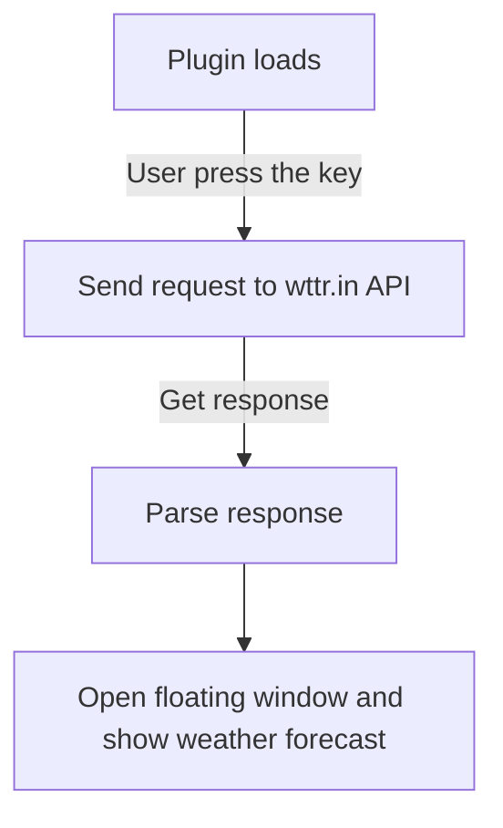

# Technical Requirements
## The project purpose
Develop a weather plugin for the [Neovim](https://github.com/neovim/neovim).

## Plugin description
User binds weather forecast display to the key. When you press a key, a floating window opens with this information about the forecast:

- date and time
- temperature (in degrees Celsius)
- presure
- UV index

## How it should work

## Tech stack
- Lua as the main language
- Neovim API
- [wttr.in API](https://wttr.in)

